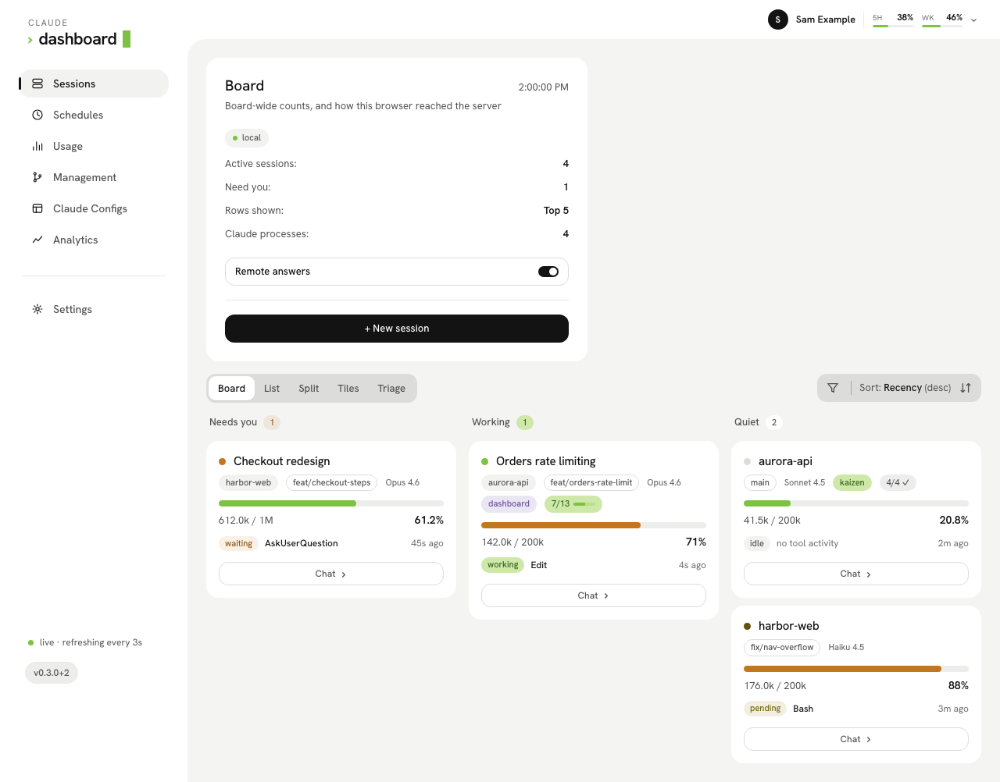
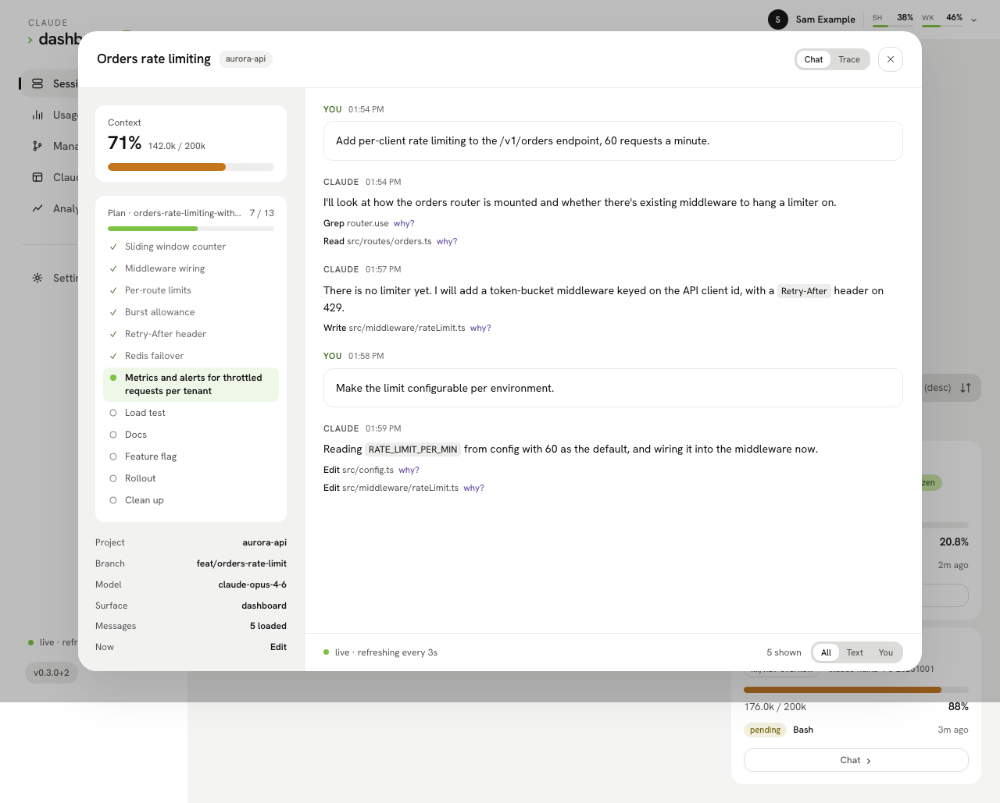
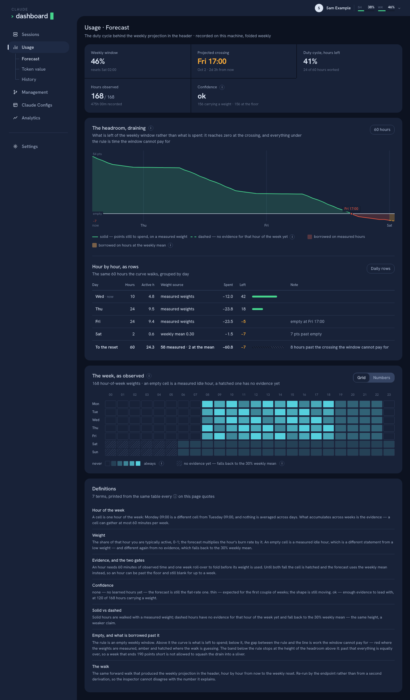
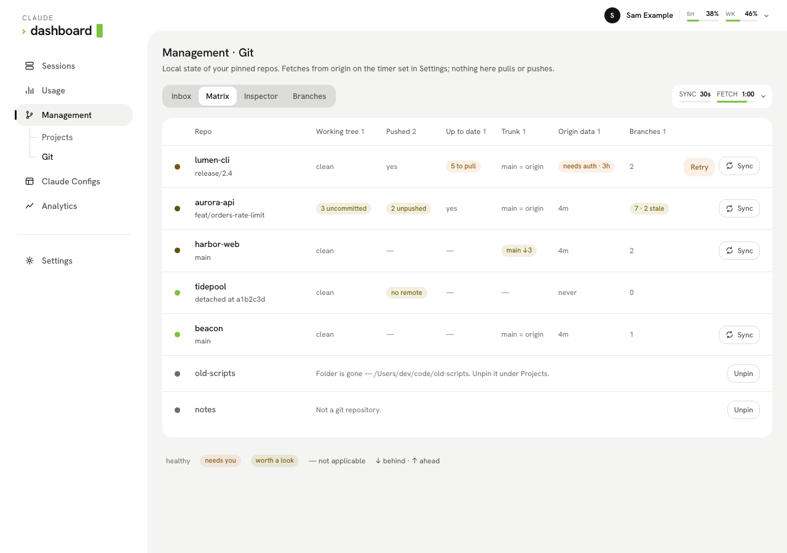
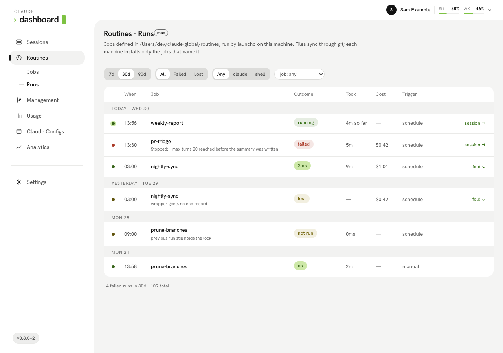
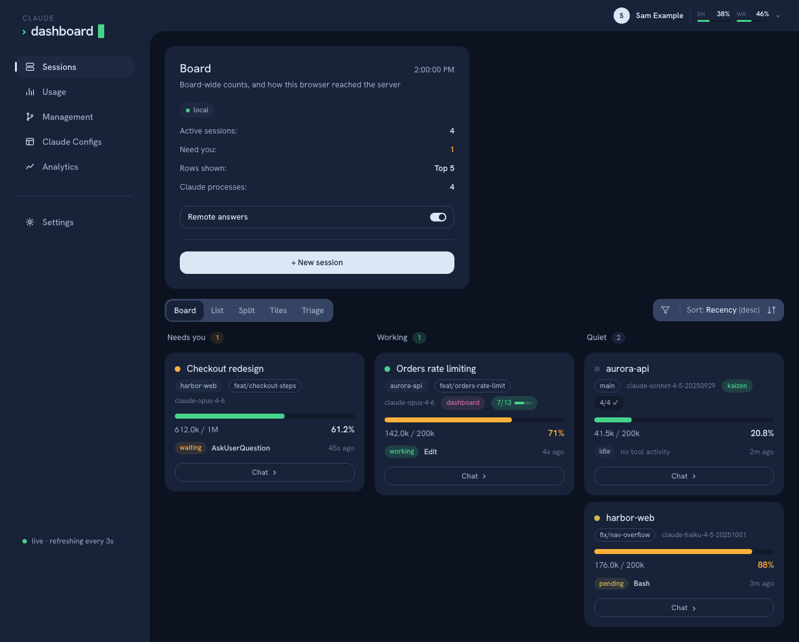
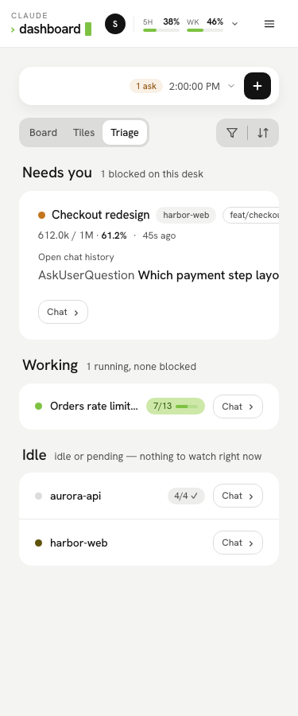

# Claude Agents Dashboard

A live, always-open monitor for **parallel Claude Code sessions** — and, once you opt in, a remote control for them. Run several `claude` sessions at once
and see in one place which ones are working, which are waiting on you, how full each context window is and what tool each one is running right now.
Answer their questions, send follow-ups and launch new sessions from the browser or your phone.



<sub>Screenshots come from the visual test suite, which runs the built client against a mocked API — the sessions and account shown are fixtures.</sub>

## What it does

- **Watch every session at once** — project, git branch, model, context usage, current tool, subagents and status, refreshed every 3 seconds. Five
  layouts (Board, List, Split, Tiles, Triage), filters and sorting.
- **Read any conversation** — a chat drawer that live-tails the transcript, with the session's plan, its pull request's checks and its facts beside it.
- **Act from anywhere** — answer an `AskUserQuestion`, send a plan back for revision, or type (or dictate) a follow-up after a turn ends, from your
  phone. Pending permission prompts show up too, so you know which terminal to go back to.
- **Start and schedule work** — launch a new headless `claude` session in any recent project, and run recurring jobs as OS-scheduled routines.
- **Keep an eye on your repos** — local git state of your pinned projects, quick pull/push, a one-tap `/git-sync`, and CodeGraph index status.
- **Know your limits** — the 5-hour and weekly rate-limit bars, with a forecast of when the current pace runs the window out.
- **Learn from finished sessions** — token post-mortems and lessons from the bundled `/kaizen` skill, and a read-only browser for all your Claude config.
- **Get pinged** — push notifications via [ntfy](https://ntfy.sh) when a session needs you, a turn finishes, a routine fails or a usage window resets.

Monitoring is **read-only and needs no setup in Claude Code**: everything comes from the transcripts Claude Code already writes to
`~/.claude/projects/*/*.jsonl`. Every feature that writes anything is opt-in.

## Requirements

**Required:**

- [Claude Code](https://docs.claude.com/en/docs/claude-code) — the dashboard shows the sessions it finds under `~/.claude/projects/`.
- **Node.js >= 20.11** (the server reads `import.meta.dirname`).
- **pnpm** — the repo pins its version in `package.json`; `corepack enable` installs the right one.
- **macOS, or Linux / WSL.** The session-liveness check uses `ps` and `lsof`.

**Optional — only for the feature named:**

| Tool | Used by |
|------|---------|
| `git` | Management › Git, Pull / Push / Sync |
| [`gh`](https://cli.github.com), signed in | the PR card in the chat drawer |
| [`codegraph`](docs/subsystems/codegraph.md) | Management › CodeGraph |
| `whisper-cpp` + `ffmpeg` | [dictation](docs/workflows/dictation-setup.md) |
| [Tailscale](https://tailscale.com) | phone access away from home, and the HTTPS that dictation needs |
| [ntfy](https://ntfy.sh) app on your phone | [push notifications](docs/workflows/push-notify-setup.md) |
| Docker | [running in a container](docs/workflows/docker.md) |
| Claude desktop app (macOS) | handing a launched session over to the desktop app |

Some parts are platform-specific: the usage bars read the OAuth token from the macOS keychain, or from `~/.claude/.credentials.json` elsewhere; routines
install as launchd jobs on macOS and crontab lines on WSL; the visual test suite runs on macOS only.

## Quick start

```bash
git clone https://github.com/futin/claude-agents-dashboard.git
cd claude-agents-dashboard
pnpm install
pnpm dev
```

Open **http://localhost:5174**. The API server and the Vite dev server run together, with hot reload.

For a production run — one process, opens your browser on start:

```bash
pnpm build   # bundles client/ into client/dist
pnpm start   # serves the built app + API on http://localhost:4173
```

**What you should see:** the most recently active sessions (top 5 by default) from the last 48 hours, each with a status dot — *working*, *question*,
*incomplete* or *idle* — plus the 5h / Week usage bars in the header. Start a `claude` session in any terminal and it appears within one poll.

**Configuration is optional.** Defaults work out of the box. To change ports, row count or time windows, copy `.env.example` to `.env` and edit it — the
full reference is [configuration](docs/workflows/configuration.md). Most day-to-day settings (theme, refresh rate, row count, notification policy) live
in the app's **Settings** tab instead and need no restart.

That's the whole basic setup. Everything below is optional.

## Features

### Watching sessions

- **[Live session monitor](docs/subsystems/sessions.md)** — one row per session: status dot (working / question / incomplete / idle), project + branch,
  model, context bar, current tool activity, expandable subagent detail, filter + sort toolbar, and a `Chat` button on every session that opens the chat —
  and names the hold (`Answer` / `Plan?` / `Reply?` / `Allow?`) when a session is waiting on you. Five layouts: **Board** (Needs you / Working / Quiet
  columns), **List**, **Split**, **Tiles** and **Triage**. A session whose `claude` process has exited is shown idle whatever its transcript says. A session
  you deleted (archived) in the Claude desktop app drops off the list too, though its transcript stays on disk.
- **[Chat drawer](docs/subsystems/chat.md)** — read any session's conversation: live-tailed, pageable back through the whole transcript, with an
  all/text/you filter and markdown rendering. Its sidecar lists the session's facts (project, branch, model, effort level, session id with a copy button)
  and its current plan. A session that ran `gh pr create` gets a **PR card** in the sidecar: state pill, `head → base`, checks, review and merge rows,
  read live through `gh`; with `gh` missing or signed out it keeps the number and title from the transcript.



### Acting on sessions from anywhere

Answers, plan verdicts, messages and dictation are session write paths. All of them sit behind one write gate — this machine, a trusted tailnet, or
`ANSWER_TOKEN` — and the **Remote answers** toggle on the Board card turns them all off at once ([remote access](docs/subsystems/remote-access.md)).

- **[Remote answers](docs/subsystems/remote-answer.md)** — answer a session's `AskUserQuestion` from your phone; the pick is delivered into the live
  session. The reason the hook install exists.
- **[Remote plan verdicts](docs/subsystems/remote-plan.md)** — send a proposed `ExitPlanMode` plan back for revision with feedback, from the same drawer.
  Reject-only: the CLI discards a hook `allow` for plans, so accepting stays a terminal action.
- **[`Allow?` tab](docs/subsystems/permission-notify.md)** — a session parked on a permission dialog gets a blue dot, an `Allow?` chat tab and a banner
  naming the command, plus a push. Display-only: you still answer in that terminal.
- **[Remote messages](docs/subsystems/remote-message.md)** — when a turn finishes while you're away, the `Stop` hook holds it open for a short window and
  you type a follow-up into the drawer; the model reads it as your next instruction and carries on. No reply and the session just stops, as it always did.
  Sessions the dashboard spawned itself are the exception to *away*: they have no terminal to type into, so their window opens — and survives the idle
  sweep — whether you're at the desk or not. In the composer, Enter sends and Tab takes the suggested reply.
- **[Dictation](docs/subsystems/dictation.md)** — a mic in that same composer: speak the follow-up instead of thumb-typing it on a phone. Recorded in the
  browser, transcoded and transcribed **on this machine** by a local whisper.cpp — no audio leaves the box. The transcript lands in the textarea as
  editable text; **send** stays a deliberate tap. Off until you install the engine, and needs HTTPS (`pnpm tunnel`) to record at all from a phone.

### Launching and scheduling work

- **[New session](docs/subsystems/spawn.md)** — the Board card's **+ New session** button starts a brand-new session from the dashboard: pick a recent
  (or pinned) project, write or dictate the prompt, choose model and effort, tap `Launch`. The server
  spawns a detached, headless `claude -p` in that project's directory and the row shows up a poll later, ordinary from then on.
  - **Resume:** once its turn is over, a session started this way offers a **resume** composer in its chat drawer that relaunches the same session id, so
    the same transcript continues and the same row wakes up.
  - **Stop:** while the server still holds a handle on the child, the expanded row and the drawer's sidecar carry a two-tap **stop** control
    (`Stop session` → `Really stop?`, with `Force stop` if the graceful signal doesn't land).
  - **Desktop app:** on macOS with the Claude desktop app installed, the launch form also offers **Desktop**: the first turn runs headless and the drawer
    follows it, then the session hands over to the desktop app on its own. A finished dashboard session can be moved there too, with **Open in desktop
    app** in its chat.
  - Off by default (empty `CLAUDE_BIN`). How much a launch can do unattended is bounded by the `SPAWN_MAX_PERMISSION` ceiling on the host, never by the
    browser. `SPAWN_OWN_ENTRYPOINT=true` makes spawns and routine runs stamp the dashboard's own entrypoint label instead of `sdk-cli`
    ([why, and why it is unsupported](docs/subsystems/spawn.md#own-entrypoint-label)).
- **[Routines](docs/subsystems/routines.md)** — scheduled jobs as markdown files in a git-synced folder (default `~/claude-global/routines/`), installed as
  launchd jobs (macOS) or crontab lines (WSL), with a Jobs ledger, an editor drawer (a Form view or the raw file) and the Runs log; a failed run sends a
  push. No scheduler runs in the server: the OS fires the plugin's wrapper, so a job still runs while the dashboard is down.

### Your repos

- **Management tab** — opens on Git.
  - **Projects:** the pinned projects and the ones on offer to pin, as tiles, columns or lists, with the pins reordered by drag or keyboard.
  - **Git** ([git-stats](docs/subsystems/git-stats.md)): read-only local git state of each pinned repo — uncommitted work, unmerged branches and how far
    they are from the trunk — in four layouts (Inbox, Matrix, Inspector, Branches). An opt-in background `git fetch`, and a Sync button that launches a
    headless `/git-sync` session in that repo. Its menu also offers a fast-forward-only **Pull** and a **Push** of that one repo, never forced.
  - **CodeGraph** ([codegraph](docs/subsystems/codegraph.md)): the `codegraph` CLI's index state of each pinned repo, with Sync and Reindex keys.

### Usage and limits

- **[Usage bars and forecast](docs/subsystems/usage-limits.md)** — the 5h / Week account rate-limit bars, in the
  [account chip](docs/subsystems/account-header.md) above every section (who the CLI is signed in as, with the full bars in its popover), same numbers as
  `/usage` in the CLI. Each has a time strip underneath: how much of the window has elapsed, your burn rate, and where the current pace projects 100% — as a
  band rather than a single tick while the estimate is still young. Opt in to recording and the weekly projection learns which hours you actually work, so
  idle nights stop being counted as burn.
- **[Usage tab](docs/subsystems/usage-limits.md#the-inspector)** — three sub-tabs:
  - **Forecast:** the duty-cycle inspector behind that projection — a 24×7 hour-of-week heatmap of the learned weights plus the forward walk to the weekly
    reset, so the projection can be checked rather than trusted. Read-only; it never exposes raw samples or file paths.
  - **[Token value](docs/subsystems/usage-limits.md#token-value-per-model-the-exchange-rate-and-its-drift):** what a percent *is* — tokens per 1% of the
    5-hour window per model (with the weekly limit's equivalent alongside), measured on this machine because the budget is never published, with a verdict
    on whether that price has drifted. Ratios between token types only — no currency anywhere.
  - **History:** the recorded 5h and weekly utilization over the last N days.

<details>
<summary>Usage › Forecast screenshot</summary>



</details>

### Insights and config

- **[Analytics tab](docs/subsystems/analytics.md)** — per-session post-mortem cards (tokens, priciest tools/subagents) paired with the lesson the `/kaizen`
  skill logged, and a verdict badge (`helped` / `hurt` / `no-effect` / `confounded`) once `/kaizen review` has measured whether that lesson's rule worked.
- **[Claude Configs tab](docs/subsystems/configs.md)** — read-only browser for all Claude config on the machine: skills, agents, commands, rules, hooks,
  settings, plugins, MCP servers (secrets redacted), per scope. A skill that ships more than `SKILL.md` opens its whole directory in a file rail beside the
  viewer.

### Notifications

- **[Push notifications](docs/subsystems/push-notify.md)** — the server publishes to an [ntfy](https://ntfy.sh) topic when a session needs you (question,
  plan, permission dialog, finished turn), when a routine fails, when a backlog-tick job stops grooming at its review cap, and when the 5-hour usage limit is
  reached and resets; tapping a session push opens that session's chat. Off by default, and the only channel that reaches you with the browser closed.
  - **Desk topic:** set a second `NTFY_TOPIC_DESK` and the pushes that fire while you're actually at the keyboard go to that topic instead, so this machine
    rings and the phone stays quiet; that one carries no deep link — tapping it only dismisses.
  - **Browser banners:** in a browser that has the `Notification` API, Settings' **Notify this browser** adds an OS banner and one beep for the sessions
    the dashboard launched itself, per device and only while that tab is open on Sessions. (WebKit has no `Notification` API in a tab, so this never fires
    on an iPhone — ntfy is the phone channel.)

### The app itself

- **[Settings tab](docs/subsystems/settings.md)** — five themes (Daylight, Midnight Radar, Graphite, Amber CRT, Nightshift), density and text scale, which section
  the app lands on, refresh rate, the scan knobs, the default model and effort for the launch panel and whether it starts on Dashboard or Desktop, the
  browser-notification switch, the push-notification policy, usage-history recording, tailnet write trust, and the remote-answer idle threshold and answer
  window — all editable in the app, no `.env` edit or rebuild. Two pages, one per store: Local (this browser) and Shared (the server's settings file). It
  also names any `.env` key edited since the server started, because those are read once, at startup.
- **[What's new](docs/subsystems/releases.md)** — the version chip at the foot of the side rail opens every release of the dashboard, newest first, read from
  the checkout's own release tags. Releases are cut once a night: one version per day, its notes grouped by area with a link to each PR.
- **[Phone access & origin badge](docs/subsystems/remote-access.md)** — reach the dashboard over LAN, Tailscale, or a tunnel; a pill on the Board card shows
  which route you're on. The layout works down to phone width.
- **[Lookout tiles](docs/subsystems/hub-widgets.md)** — `GET /api/hub/widgets` serves three tiles to Lookout, the sibling hub app, through the
  `lookout-widgets` package.

<details>
<summary>More screenshots</summary>

| | |
|---|---|
|  |  |
| Management › Git (Matrix) | Routines › Runs |
|  |  |
| Midnight theme | Phone width (Triage) |

</details>

## Optional setup

- **All six hooks, one command** — `pnpm hooks:install` symlinks them into `~/.claude` and merges the seven settings entries, idempotently, with `--dry-run`
  and `--uninstall`: [setup](docs/workflows/hooks-setup.md). Everything below that mentions a hook is what it automates; you still choose the token, the
  topic, and whether remote answering is on. One of the six is not a dashboard feature at all: `kill-guard.sh` refuses a broad `pkill`/`killall` from a
  Bash tool call, which is what once took this repo's own dev server down from a session running somewhere else.
- **Phone / away-from-home access** — nothing to configure in the app for LAN or Tailscale; a public tunnel's hostname goes in `ALLOWED_HOSTS`. `pnpm
  tailnet` publishes the dashboard to your tailnet over HTTPS. See [remote access](docs/subsystems/remote-access.md) for LAN, Tailscale, and tunnel
  options.
- **Remote answers hook** — 4 steps, ~2 minutes: [setup](docs/workflows/remote-answer-setup.md).
- **Push notifications to your phone** — 6 steps, ~5 minutes: pick a secret ntfy topic, subscribe the phone, set two `.env` values, enable it in Settings:
  [setup](docs/workflows/push-notify-setup.md).
- **Dictation (local whisper)** — 5 steps, ~5 minutes and ~150MB of disk: `brew install whisper-cpp` (plus `ffmpeg`), a model file, one `.env` line, and
  `pnpm tunnel` for phone use: [setup](docs/workflows/dictation-setup.md). Read the [security posture](docs/subsystems/dictation.md#security-posture) first
  if other devices can reach the dashboard — the endpoint spawns processes, and every tailnet device may call it while tailnet trust is on (the default); a
  LAN client needs `ANSWER_TOKEN`.
- **New sessions (spawn)** — 1 step, ~1 minute: point `CLAUDE_BIN` at your `claude` binary (`which claude`), and set `SPAWN_MAX_PERMISSION` below its
  `auto` default if that's more than you want an unattended launch to have. Read the [security posture](docs/subsystems/spawn.md#security-posture) first —
  this is the widest write surface in the app; it sits behind the same write gate (this machine, a trusted tailnet, or `ANSWER_TOKEN`), and the
  remote-answer toggle, so flipping that pill off stops launching too.
- **Docker** — production and dev images, read-only `~/.claude` mount: [docker](docs/workflows/docker.md). Writes from a container need `ANSWER_TOKEN`.
- **Configuration** — everything is optional, defaults work out of the box; the full `.env` reference is in [configuration](docs/workflows/configuration.md).

## Install the skills

The repo is its own plugin marketplace; the plugin itself lives in `plugin/`, so nothing else in the repo installs with it:

```bash
claude plugin marketplace add futin/claude-agents-dashboard --sparse .claude-plugin plugin
claude plugin install claude-agents-dashboard@claude-agents-dashboard-marketplace
```

`--sparse` keeps the marketplace clone to the two directories the install reads. That gives every project on the machine two skills:

- **`/kaizen`** — a post-mortem of a finished session. It appends one lesson line to `~/.claude/session-analytics-log.md`, which is what the **Analytics**
  tab reads; without it the tab stays empty.
- **`/git-sync`** — the repo's git chores in one pass: commit what's lying around behind a secret scan, sync and verify the trunk, push it, and prune
  branches proven merged. The trunk is pushed once it verifies; every deletion, branch push and stash change is asked first.

The plugin also carries `plugin/lib/run-routine.mjs`, the wrapper every [routine](docs/subsystems/routines.md) runs: reconcile points launchd and cron at the
installed copy, so Routines need the install too.

The installed copy is a cached snapshot of GitHub's `main`, not a link to this checkout, so a skill edit in `plugin/` reaches a session only once it is
committed and pushed and `pnpm plugin:sync` has run. The script compares `plugin/` with the installed copy, refuses a tree GitHub does not have (off
`main`, uncommitted, unpushed or behind), reinstalls, and re-checks the result; restart Claude Code afterwards.

## How it works

1. The browser polls `GET /api/sessions` every 3 seconds.
2. The server lists the transcripts under `~/.claude/projects`, ranks them by recency, and tail-reads the last 256 KB of each — enough to derive tokens,
   model, context window, current activity and status. A `ps` + `lsof` pass marks sessions whose `claude` process has exited as idle.
3. Detail views (subagents, chat pages, config, analytics) fetch lazily when you open them.

No database and no daemon: state lives in memory, plus a few gitignored files in the checkout for settings and opt-in usage recording. The server is
TypeScript run directly by `tsx` in dev and prod alike; the client is Vite + React. The only feature that ships hooks into Claude Code is the opt-in
remote-control set above. The full picture is in [`docs/overview.md`](docs/overview.md).

## Footprint and security

- **Dependencies:** the server uses Node built-ins plus two packages, [`lookout-widgets`](docs/subsystems/hub-widgets.md#the-dependency-exception) and
  `release-kit`, each with zero runtime dependencies of its own.
- **Outbound calls:** exactly two kinds — the ntfy push (only when you configure a topic) and the usage-bar read from Anthropic's API (`SHOW_USAGE=false`
  turns it off). Besides those, the server runs local programs only when a feature you turned on needs them: `git fetch` on the pinned repos when you turn
  the Git fetch timer on, the fetch and push behind Pull and Push when you press them, `gh pr view` behind the PR card, and `claude` for spawns and
  routines.
- **Writes:** the app never writes to transcripts. Every write endpoint — answers, messages, launches, git actions — is refused unless the request comes
  from this machine, from a tailnet device while **Settings › Shared › Trust tailnet devices** is on (the default), or carries `ANSWER_TOKEN`. A LAN client
  without the token is read-only. Both servers bind all interfaces, and a DNS-rebinding guard answers only known host names (`ALLOWED_HOSTS` adds more).
  Details: [remote access](docs/subsystems/remote-access.md).

## Troubleshooting

- **The list is empty.** Only transcripts modified in the last 48 hours count (`LOOKBACK_HOURS`, or Settings' scan knobs). Check that
  `~/.claude/projects/` holds `.jsonl` files from a recent session.
- **A session that ended still shows as working.** The liveness check works per directory and fails open: two sessions in the same directory can't be
  told apart, and the check is skipped when `ps` or `lsof` is unavailable — always in Docker, where `SKIP_PROC_SCAN` defaults to `true`.
- **No usage bars.** On macOS, the first keychain read pops a system prompt — approve it with **Always Allow**. Elsewhere the token comes from
  `~/.claude/.credentials.json`; in Docker, pass it as `CLAUDE_CREDENTIALS_JSON` ([docker](docs/workflows/docker.md)). An expired token is renewed by
  asking the CLI (`USAGE_AUTO_REFRESH`).
- **Buttons do nothing from the phone (403).** The request isn't from a trusted origin: use Tailscale with tailnet trust on, or set `ANSWER_TOKEN`.
- **An `.env` change has no effect.** `.env` is read once at startup — restart the server. Settings lists the keys edited since it started.
- **Port already in use.** Set `PORT` (prod / API, default 4173) or `WEB_PORT` (dev UI, default 5174) in `.env`.

## Development

```bash
pnpm dev         # API + Vite with hot reload on http://localhost:5174
pnpm test        # node-assert tests over the domain logic, then the kaizen skill's suite
pnpm typecheck   # tsc --noEmit
pnpm test:skills # git-sync's own suite, ~4 min — only needed when you change plugin/skills/git-sync/
pnpm test:visual # screenshot/overflow/contrast suite, macOS only; --update-snapshots re-baselines (docs/subsystems/visual-tests.md)
```

Layout: `server/` (Node + TypeScript), `client/` (Vite + React), `shared/` (the typed API contract both sides use), `test/`, and `plugin/` (the installable
skills). `main` takes changes only through pull requests with a [Conventional Commits](https://www.conventionalcommits.org) title; CI runs typecheck,
build and tests on each one, and `feat` / `fix` / `perf` merges roll into the nightly release. The working rules for contributors — human or Claude — are in
[`.claude/CLAUDE.md`](.claude/CLAUDE.md); CI and releases are in [ci](docs/workflows/ci.md).

## Documentation

[`docs/overview.md`](docs/overview.md) is the entry point — domains, data flow, HTTP surface, repo layout, and the map of every doc. Per-subsystem deep
dives (mechanism + invariants) live in [`docs/subsystems/`](docs/subsystems/); runnable procedures (configuration, Docker, the hook installer, the
remote-answers hook, push-notification and dictation setup, CI and releases) in [`docs/workflows/`](docs/workflows/).

## Not included (yet)

- Estimated USD cost per session. (Whole-session token totals live in the **Analytics** tab — run `/kaizen` on a session and it appears there.)

<!-- docs-sync:
  sources:
    - server/
    - client/
    - scripts/
    - package.json
  kind: readme
  verified: 648982fb0136a7a8bfbc41a87eb7b490e91d64d7
-->
