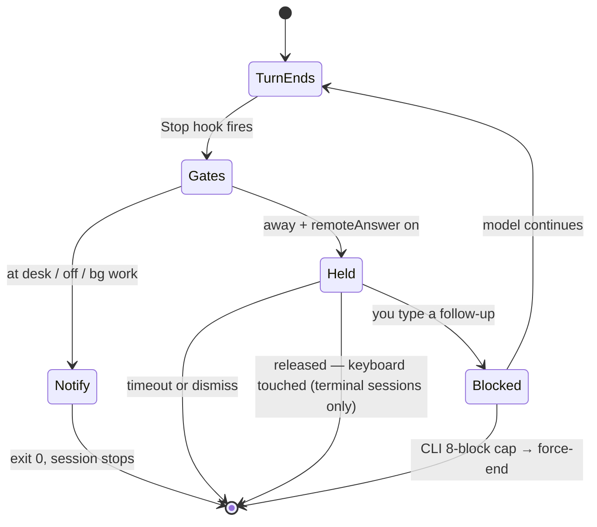

# The Stop-hook chat loop

The strangest of the five, because it turns a lifecycle hook into a conversation.

> Mental model: a `Stop` hook that **blocks** does not end the turn — the model reads the
> reason and keeps working. When it next finishes, `Stop` fires again. That is a loop, and
> the loop is the feature.

## 1. The loop



## 2. `stop_hook_active` was demoted from a guard to a payload field

Conventionally a `Stop` hook checks `stop_hook_active` and bails, to avoid an infinite loop.
This one can't:

```bash
# scripts/stop-notify-hook.sh:17-21
# The CLI caps consecutive Stop blocks at 8 (CLAUDE_CODE_STOP_HOOK_BLOCK_CAP),
# then force-ends the turn — so a phone conversation is at most 8 replies per
# stretch. stop_hook_active no longer short-circuits: mid-conversation stops
# must re-hold (that IS the chat loop); it rides in the POST body instead so the
# server skips the push you would not want mid-chat.
```

Bailing on that flag would cap the conversation at exactly **one** reply, because the second
turn-end is by definition a mid-hook-conversation stop.

So the flag changed jobs. It is no longer control flow; it is data:

```bash
# scripts/stop-notify-hook.sh:196-202
BODY=$(jq -cn \
  --arg sid "$SESSION_ID" \
  --arg pm "$PERM_MODE" \
  --argjson sha "$SHA" \
  --argjson hl "$HEADLESS" \
  --argjson t "$((TIMEOUT_S * 1000))" \
  '{sessionId: $sid, timeoutMs: $t, permissionMode: $pm, stopHookActive: $sha, headless: $hl}') || notify_fallback
```

**Why this is safe:** the loop bound moved from the script to the platform. The CLI's own
8-block cap is the guard now, and it cannot be misconfigured away by editing this script —
because the script no longer holds that responsibility.

**The bad alternative** is keeping the guard and finding some other way to allow more than one
reply, e.g. a counter in the script or a server-side reply budget:

| | rely on the CLI cap (chosen) | keep the guard + own counter |
|---|---|---|
| Loop safety | Enforced by the CLI, unconditionally | Enforced by your own bookkeeping |
| State needed | None — the script is stateless | A counter that must survive across subprocess invocations |
| Conversation length | Up to 8 replies | Whatever you implement |
| Risk | You inherit a cap you don't control (8, via env var) | A bug in your counter is an infinite loop |

The script is invoked fresh per stop, with no memory. Any counter would have to live on disk
or on the server, and a bug in it means a session that never stops. Delegating to the
platform is strictly better here.

## 3. Two exits, and the old behaviour preserved byte-for-byte

`notify_fallback` is a shell function used as a jump target:

```bash
# scripts/stop-notify-hook.sh:123-130
notify_fallback() {
  [ "$SHA" = "true" ] && exit 0
  BODY=$(jq -cn --arg sid "$SESSION_ID" --arg pm "$PERM_MODE" \
    '{sessionId: $sid, event: "stop", permissionMode: $pm}') || exit 0
  curl -sf -m 1 -X POST -H 'Content-Type: application/json' "${AUTH[@]}" \
    -d "$BODY" "$DASH/api/notify/event" > /dev/null 2>&1 || true
  exit 0
}
```

Every non-hold path calls it. The header states the contract plainly:

```bash
# scripts/stop-notify-hook.sh:6-12  (abridged here — lines 9-11 elided, line 12 truncated)
# Two paths out of every run (the token-renewal turn, CLAUDE_DASHBOARD_REFRESH, takes neither — see below):
#   at the desk / feature off → POST /api/notify/event (the old fire-and-forget
#     push trigger) and exit 0 — byte-for-byte the pre-feature behaviour;
#   away + remote answers on  → POST /api/messages/wait, held.
```

**Why it matters:** the "task finished" push predates remote messages. Adding a hold could
easily have re-routed the old path through the new one — and then a bug in the hold logic
would take out notifications too. Instead the gates *add* a path; they never reroute the
existing one. Even `notify_fallback` is reachable from mid-flight failures: a non-2xx from
`/api/messages/wait` (feature flipped off, server restarted) falls back to the plain notify
rather than exiting silently.

Note also the `[ "$SHA" = "true" ] && exit 0` at the top of the function: mid-conversation
stops skip the notify, because *"the old script exited before notifying there too."* Even the
suppression is a preserved behaviour, not a new one.

## 4. Background work aborts before anything else

This runs before the health probe — before any network call at all:

```bash
# scripts/stop-notify-hook.sh:53-56
# Count in-flight background work. Missing keys -> [] -> 0 (safe fallback).
# Only the hook payload carries this, which is why the guard stays here.
bg=$(printf '%s' "$INPUT" | jq '((.background_tasks // []) | length) + ((.session_crons // []) | length)' 2>/dev/null || echo 0)
[ "${bg:-0}" -gt 0 ] 2>/dev/null && exit 0
```

**Why this one gate cannot move to the server:** the dashboard reads transcripts off disk. It
has no way to see in-flight background tasks or session crons — that information exists only
in the hook payload. Most of this subsystem pushes decisions serverward (prose, timeouts,
policy) precisely because the server is testable; this is the counter-example, and the comment
marks it as such.

**Why it aborts rather than holding:** a turn that ends with a background agent still running
is not really finished. The model will be re-invoked when that agent reports, so holding the
turn open would park a session that is about to continue on its own — and would burn one of
the 8 available blocks doing it.

## 5. The prose is a contract between two modules

`composeReason` carries your follow-up **and** re-injects the away-mode instructions:

```ts
// server/lib/remote-message-prose.ts:9-14
export const REMOTE_MESSAGE_HEAD =
  'The user is away from the terminal and sent this follow-up from the dashboard; treat it as their next message:\n';

export const REMOTE_MESSAGE_TAIL =
  '\n\nContinue working on it now. The user is still away: put any decision through the AskUserQuestion tool, never end the turn on a prose '
  + 'question, and prefer already-permitted tools — a permission dialog would park the session until they return.';
```

`messages.ts`'s `composeReason` is now a one-line call to `wrapRemoteMessage`, which puts your trimmed text between those two constants.

**Why the instructions ride here:** as [the lifecycle chapter](./lifecycle.md) covers,
`UserPromptSubmit` does not fire on a hook-continued turn. There was no user prompt. So
`remote-decision-hook.sh` never runs and its injection never happens — this reason string is
the only vehicle left.

The same wording has to come back out. The CLI records the Stop block in the transcript, and
[`chat.ts`](../../../../../server/lib/chat.ts) unwraps that record back into a plain drawer message with `unwrapRemoteMessage`, whose matcher is
built from the very same two constants:

```ts
// server/lib/remote-message-prose.ts:20-23
// The CLI records the Stop block under a `Stop hook feedback:` line; both ends are anchored so a near-miss fails closed.
const MATCHER = new RegExp(
  '^(?:Stop hook feedback:\\n)?' + escapeRegExp(REMOTE_MESSAGE_HEAD) + '([\\s\\S]*)' + escapeRegExp(REMOTE_MESSAGE_TAIL) + '\\s*$'
);
```

Without it, your one-line follow-up would display in the chat drawer as the whole four-line
wrapper, instructions and all.

**The bad alternative** is a sentinel marker (`<!--remote-msg-->`) or a JSON envelope —
trivially parseable, no duplicated prose:

| | shared prose constants (chosen) | sentinel / envelope |
|---|---|---|
| What the model reads | Clean natural-language instruction | A marker it must be told to ignore |
| Parse robustness | Exact — wrap and unwrap derive from one pair of constants | Exact |
| Drift protection | Structural: one owner module, nothing to keep in step | Not needed |
| Failure mode | A record that doesn't match is dropped (fails closed) | — |

They chose the *model's* reading experience over the parser's. The first version paid for that with two hand-kept copies of the prose — the wrapper in
`messages.ts` and a hand-written `REMOTE_MESSAGE_RE` regex in `chat.ts` — and a test pinning them together. That copy is gone: both directions now derive
from [`remote-message-prose.ts`](../../../../../server/lib/remote-message-prose.ts), so they cannot drift apart. One constraint survives the refactor, and
the module's header names it: every transcript already on disk carries the old wording, so changing the constants would stop past follow-ups unwrapping.

## 6. Three stores, one reaper policy

`pending.ts` and `plans.ts` wait for you to *answer something*. `messages.ts` waits for you to
*maybe say something*. All three release a hold when you walk back to your desk, and all three
ask the same question to decide it:

```ts
// server/lib/idle.ts:45-53
export function backAtDesk(): boolean {
  const thresholdSecs = getSettings().idleSecs;
  // Checked before the read, not inside `atDesk`: the reading costs an `ioreg`
  // spawn and a zero threshold makes the answer false regardless, so asking
  // would be ~40ms spent on a foregone conclusion. `atDesk` re-checks it anyway
  // for callers that already hold a reading.
  if (thresholdSecs === 0) return false;
  return atDesk((idleReader ?? readIdleSecs)(), thresholdSecs);
}
```

**Why:** when you walk back to your desk, the right behaviour is for the session to go back to the terminal
immediately — not to make you find a phone panel and dismiss it. Each store settles such a hold as `released`.

This policy first lived only in `messages.ts`, which is why held questions and plans used to sit parked until their deadlines. `idle.ts` now owns
it, and [`wait-store.ts`](../../../../../server/lib/wait-store.ts) runs it: each store's `sweepIdle()` is a one-line call into the shared sweep.

```ts
// server/lib/wait-store.ts:120-126
    sweepIdle() {
      const release = releasableEntries();
      if (release.length === 0) return 0; // nothing to release — don't spawn ioreg
      if (!backAtDesk()) return 0;
      for (const entry of release) settle(entry, opts.released);
      return release.length;
    },
```

What differs per store is an option. `messages.ts` is the one that passes it, because it skips headless holds:

```ts
// server/lib/messages.ts:48-49
  // The headless exemption — see {@link sweepIdle}: a `claude -p` session has no terminal to come back to, so the dashboard window stays its only channel.
  releasable: entry => !entry.headless
```

A dashboard-spawned `claude -p` session has no terminal, so coming back to the desk gives you no other way to reply. Its hold stays open until you
answer, dismiss it or it times out.

And the reaper self-terminates. There is one, shared by all three stores. Each tick asks `backAtDesk()` once, not once per store, and only with something to
release:

```ts
// server/lib/wait-store.ts:76-83
function ensureReaper(): void {
  if (reaper) return;
  reaper = setInterval(() => {
    reapIdle();
    stopReaperIfEmpty();
  }, 5_000);
  reaper.unref();
}
```

**The bad alternative** is a permanent 5-second interval started at boot:

| | on-demand reaper (chosen) | always-on interval |
|---|---|---|
| Work when idle | None — no timer runs | 17,280 ticks/day to find every store empty |
| Holds the process open | No — `unref()` | Needs `unref()` anyway |
| Complexity | `ensureReaper` + `stopReaperIfEmpty` | One line at boot |

The stores are empty the overwhelming majority of the time, so an always-on timer would have nothing to do for most of its life. The `ioreg` cost is a
separate guard: `reapIdle` calls `backAtDesk()` only with something to release, so an idle server and a headless-only hold never spawn it.

Note the fail direction. It is the *same* as the hook's, never act on a guess. Here that keeps the hold open, where the hook's guess keeps the dialog in
the terminal:

```ts
// server/lib/idle.ts:35-40
 * Fail directions, both deliberately "stay held":
 *  - unreadable idle (Docker, non-macOS) → false. Never end a wait on a guess;
 *    the deadline timer is the reaper of last resort. Same direction
 *    `ask-remote-hook.sh` takes for the same reason.
 *  - `idleSecs === 0` → false. Zero disables the idle gate everywhere else
 *    (the hooks skip the check entirely), so it disables auto-release too.
```

Auto-releasing on a guess would end a turn you were about to reply to. See
[Fail-open](./fail-open.md) for all three directions side by side.

---

**Next:** [Fail-open, hook by hook](./fail-open.md).

[↑ back to contents](../README.md)
